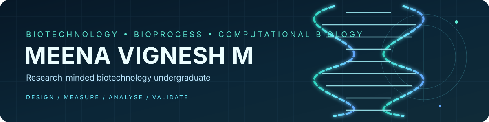

### Biotechnology undergraduate | Bioprocess engineering | Computational biology

---

## 01 / Research direction

I am a B.Tech Biotechnology undergraduate at **Sethu Institute of Technology**, building practical foundations in **bioprocess engineering, computational biology and sustainable biotechnology**.

My interests connect biological systems with measurable engineering and computational methods:

- **Bioprocess engineering** — fermentation, bioreactor fundamentals, mass transfer, process variables and scale-up.
- **Computational biology** — sequence analysis, bioinformatics algorithms and reproducible workflows.
- **Sustainable biotechnology** — biodegradation, biological wastewater treatment and resource recovery.
- **Research practice** — literature-based problem framing, transparent methods, scientific documentation and evidence-led interpretation.

I distinguish clearly between a concept, a calculation, a simulation and an experimentally validated result.

## 02 / Selected research & engineering projects

<table>
<tr>
<td width="50%" valign="top">

### 🧬 AEGIS Bio-Node
**Modular gyroid perfusion bioreactor concept**

Interactive engineering concept exploring a gyroid-based perfusion architecture and proposed optical sensor-docking interfaces.

- Procedural 3D assembly and component views
- Gyroid level-set visualization
- Straight-tube flow reference calculations
- Engineering limitations and validation pathway

**Stage:** concept and browser visualization; not a validated reactor or CFD study.

[Repository ↗](https://github.com/meenavignesh-svg/AEGIS-BIO-NODE) · [Live prototype ↗](https://meenavignesh-svg.github.io/AEGIS-BIO-NODE/)

</td>
<td width="50%" valign="top">

### 🧫 BioSentinel
**Deterministic bioinformatics workbench**

Browser-first educational tool for transparent sequence-analysis operations.

- FASTA/plain-sequence input
- GC content and reverse complement
- Transcription, translation and ORF scanning
- Restriction-site screening and basic primer checks
- JSON report export

**Stage:** educational software; not a clinical or validated diagnostic tool.

[Repository ↗](https://github.com/meenavignesh-svg/biosentinel_ai) · [Live prototype ↗](https://meenavignesh-svg.github.io/biosentinel_ai/)

</td>
</tr>
<tr>
<td width="50%" valign="top">

### ♻️ PEG Biodegradation
**Wastewater-treatment process concept**

A visual concept exploring a proposed treatment sequence for PEG-containing wastewater, including a biochar–hydrogel support-bed idea.

**Stage:** early concept and 3D process visualization. No measured removal efficiency or microbial performance is claimed.

[Repository ↗](https://github.com/meenavignesh-svg/PEG-BIODEGRADATION) · [Live prototype ↗](https://meenavignesh-svg.github.io/PEG-BIODEGRADATION/)

</td>
<td width="50%" valign="top">

### 🧪 Rosalind Complete Suite
**Computational biology problem-solving**

A structured learning record for Rosalind exercises, beginning with Python Village.

- Problem statements and I/O expectations
- Documented Python solutions
- Basic complexity explanations
- Reproducible solution records

**Progress:** 3 of 6 Python Village problems documented.

[Repository ↗](https://github.com/meenavignesh-svg/rosalind-complete-suite)

</td>
</tr>
<tr>
<td width="50%" valign="top">

### 📚 Daily Bioinformatics Paper Writer
**Literature workflow automation**

Research-support workflow to organize publications into evidence matrices and export Markdown/BibTeX.

- DOI/title deduplication
- Methods, datasets, findings and limitations
- Verification markers for claims
- AI-assisted drafting with source checking

**Stage:** research-support software; verify summaries against original papers.

[Repository ↗](https://github.com/meenavignesh-svg/daily-paper-writer-)

</td>
<td width="50%" valign="top">

### 🧬 CodeAlpha Biotechnology Internship
**Biotechnology task portfolio**

Documented submissions covering medical biotechnology advancements, a Ginkgo Bioworks case study and AI/ML in biotechnology.

[Repository & deliverables ↗](https://github.com/meenavignesh-svg/CodeAlpha-Biotech-Internship)

</td>
</tr>
</table>

## 03 / Learning & recognition

- **NPTEL Domain Scholar — Computational Biology**
- **NPTEL Human Physiology** — completed with a score of 76
- **Student of the Year — Biotechnology**, Sethu Institute of Technology
- Continuing independent practice in Python, bioinformatics, technical communication and bioprocess fundamentals

## 04 / Technical toolkit

| Domain | Current focus |
|---|---|
| Biotechnology | Microbiology, physiology, molecular biology, biochemistry |
| Bioprocess | Fermentation, bioreactor fundamentals, mass transfer, process calculations |
| Computational biology | Sequence analysis, Rosalind exercises, reproducible workflows |
| Programming | Python fundamentals, data handling, Git/GitHub |
| Engineering communication | Process diagrams, assumptions, units, limitations and technical reports |

*These represent learning and project experience, not claims of professional mastery.*

## 05 / What I am working to improve

- [ ] Fermentation growth-kinetics calculations with reproducible datasets
- [ ] Oxygen-transfer and (k_La) estimation with stated assumptions
- [ ] Python notebooks for bioprocess data analysis
- [ ] Automated tests and example datasets for bioinformatics tools
- [ ] Comparison of calculations with published data
- [ ] A focused experimental or literature-based research study

## 06 / Research & internship interests

I welcome opportunities to contribute as a student intern or research trainee in:

- Bioprocess and fermentation laboratories
- Bioreactor design and process-development groups
- Bioinformatics and computational biology projects
- Environmental and sustainable biotechnology research

I can contribute to literature reviews, data organization, basic Python analysis, technical documentation and supervised laboratory work. I welcome technical feedback on my assumptions, calculations and validation plans.

### Let's connect and build something scientifically useful.

 

**BIOLOGY → PROCESS DESIGN → MEASUREMENT → ANALYSIS → VALIDATION**

Building practical biotechnology skills through documented, reproducible work.

