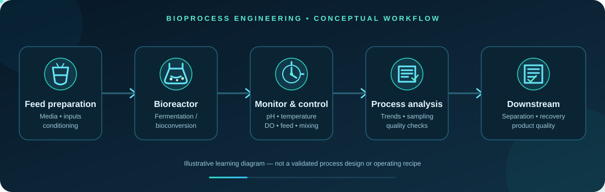

**Biotechnology undergraduate | Building toward bioprocess engineering**

---

## About

I’m a Biotechnology undergraduate interested in **how biological systems become controllable, measurable, and scalable processes**. I’m building toward bioprocess engineering, with a particular interest in bioreactors, fermentation, process monitoring, and sustainable biomanufacturing.

My repositories currently include **early-stage engineering concepts, visual prototypes, and computational learning projects**. My goal is to develop them into stronger technical work supported by calculations, reproducible methods, and evidence—not just attractive interfaces.

## Bioprocess at a glance

Conceptual learning diagram only — not a validated process design or operating procedure.

## Featured projects

### 01 · AEGIS Bio-Node — bioreactor engineering concept

Explore a conceptual reactor architecture with a 3D visualization of a modular culture core and sensor/control interfaces.

- **Engineering themes:** reactor architecture, perfusion concepts, sensing, and closed-loop control ideas
- **Stage:** concept / interactive visualization
- **Evidence boundary:** any displayed performance values are simulated demonstration values, not experimental results or validated performance.

[**Repository →**](https://github.com/meenavignesh-svg/AEGIS-BIO-NODE) · [Live prototype →](https://meenavignesh-svg.github.io/AEGIS-BIO-NODE/)

### 02 · PEG biodegradation — biological treatment concept

A process-flow concept for exploring a proposed biological treatment route for PEG-containing wastewater.

- **Engineering themes:** process sequencing, biological treatment, and biochar-based support-material ideas
- **Stage:** concept / demonstration
- **Evidence boundary:** no claim of measured PEG removal, treatment efficiency, or validated plant performance.

[**Repository →**](https://github.com/meenavignesh-svg/PEG-BIODEGRADATION) · [Live prototype →](https://meenavignesh-svg.github.io/PEG-BIODEGRADATION/)

### 03 · Sustainable sewage-system concept

An exploration of wastewater sustainability and system-level treatment ideas. Review the repository for its current implementation and limitations.

[**Repository →**](https://github.com/meenavignesh-svg/the_sustainable_sewage-system)

### 04 · BioSentinel AI — sequence-analysis workbench

A browser-based educational workbench for deterministic biological-sequence operations. This is a supporting project for building computational and data-handling skills.

[**Repository →**](https://github.com/meenavignesh-svg/biosentinel_ai) · [Live prototype →](https://meenavignesh-svg.github.io/biosentinel_ai/)

### 05 · Rosalind Complete Suite — computational practice

A learning repository for bioinformatics-style algorithmic exercises and structured problem-solving practice.

[**Repository →**](https://github.com/meenavignesh-svg/rosalind-complete-suite)

---

## How I approach an engineering problem

1. **Define the objective:** specify the process goal and a measurable success criterion.
2. **Map the process:** identify inputs, outputs, unit operations, and constraints.
3. **Model before claiming:** state assumptions and use appropriate balances or simple calculations.
4. **Choose measurable variables:** for example, pH, temperature, dissolved oxygen, agitation, feed rate, or residence time—depending on the process.
5. **Separate evidence types:** label values as measured, calculated, simulated, sourced, or hypothetical.
6. **Check failure modes:** consider contamination, mass transfer, mixing, safety, and scale-up limitations.
7. **Make it reproducible:** document methods, units, data sources, limitations, and what should be tested next.

## Skills I’m developing

| Area | Current focus |
|---|---|
| Bioprocess fundamentals | Fermentation, bioreactors, process variables, and scale-up concepts |
| Process engineering | Mass and energy balances, process-flow diagrams, and basic instrumentation |
| Computational tools | Python, Git/GitHub, data analysis, and plotting |
| Technical communication | Clear assumptions, limitations, diagrams, and project documentation |
| Sustainable biotechnology | Waste-treatment concepts and resource recovery |

I’ll expand this list as I gain practical experience and can demonstrate skills in documented work.

## Current learning roadmap

- [ ] Practice mass and energy balances with worked examples
- [ ] Study microbial growth kinetics and fermentation calculations
- [ ] Learn mixing and oxygen-transfer fundamentals
- [ ] Practice process-flow diagrams and introductory P&ID interpretation
- [ ] Build small, reproducible Python models with stated assumptions
- [ ] Compare model outputs against published data where appropriate
- [ ] Document uncertainty, biosafety, contamination risks, and scale-up constraints

## Let’s connect

I’m interested in student collaborations and feedback related to **bioreactors, fermentation, process monitoring and control, downstream processing, and sustainable biomanufacturing**.

If you review a project, I’d especially value feedback on its assumptions, calculations, experimental design, and what evidence would be needed to validate the concept.

**Biology → Process Design → Measurement → Control → Validation**

*Learning the engineering behind reliable, scalable bioprocesses.*

